<p align="right"><a href="README.md">Français</a> | <strong>English</strong></p>

# Predicting forest fires in Tunisia — comparing Machine Learning models

<p align="center">
  <a href="https://yuumii05.github.io/predicting-forest-fire-machine-learning/">
    
  </a>
  <br>
  <a href="https://yuumii05.github.io/predicting-forest-fire-machine-learning/"><strong>https://yuumii05.github.io/predicting-forest-fire-machine-learning/</strong></a>
</p>

> **Given the weather of a single day, can we predict whether a Tunisian forest will catch fire?**
> Six algorithm families, two baselines, a dataset built from NASA satellite data, year-grouped nested cross-validation, and an analysis of *why* the models succeed or fail.

Every summer, the forests of north-western Tunisia (Jendouba, Béja, Bizerte, Le Kef…) and of the centre (Kasserine) burn.
This project builds a real dataset covering 13 summers and rigorously compares classification models that could help
**prioritise surveillance** of high-risk areas and days.

*Project carried out for the Machine Learning course at ESGITECH. The website, notebook and figures are in French.*

---

## Results at a glance

| Model | Family | Average precision — weather + FWI | Average precision — weather only |
|---|---|---|---|
| **Random Forest** | Ensemble (bagging) | **0.199** ± 0.055 | **0.176** ± 0.034 |
| Gradient Boosting | Ensemble (boosting) | 0.197 ± 0.052 | 0.170 ± 0.034 |
| Logistic regression | Linear | 0.191 ± 0.043 | 0.172 ± 0.040 |
| k-NN | Instance-based | 0.187 ± 0.036 | 0.157 ± 0.024 |
| SVM (RBF kernel) | Kernel methods | 0.179 ± 0.041 | 0.157 ± 0.027 |
| Decision tree | Trees | 0.166 ± 0.034 | 0.156 ± 0.026 |
| *Official FWI index alone* | *Baseline* | *0.182 ± 0.052* | — |
| *Random* | *Baseline* | *0.104* | *0.104* |

*Average precision = area under the precision-recall curve (positive class = fire). Mean ± standard deviation over 15 test folds
grouped by year (5 folds × 3 repetitions). A random model scores the fire-day rate: 0.104.*

**Key takeaways:**

1. **Predicting a fire from the weather is hard.** The best model (Random Forest) is **1.9× better than random** at flagging
   high-risk days (ROC-AUC ≈ 0.69). Weather tells you when the forest is *ready* to burn, not when someone lights the spark —
   and most fires in Tunisia are human-caused.
2. **The families are close.** With the FWI indices, Random Forest, Gradient Boosting, logistic regression, k-NN and SVM are
   **statistically tied** (corrected t-test, p > 0.3). Only the single decision tree is significantly behind. The official
   FWI index used alone does almost as well in cross-validation.
3. **Shuffling days distorts everything.** With standard cross-validation, k-NN gains **+23 %** and jumps from 4th to 1st place:
   a large fire lasts several days, so the model recognises "yesterday's fire". Folds are therefore grouped by year.
4. **On future summers (2022–2025)**, every model stays above random but loses precision; the FWI index alone barely beats
   random (ROC-AUC 0.51). This is where machine learning adds the most.
5. **Feature scaling** improves k-NN by +11 % (10 features), changes nothing for trees, and even slightly hurts the SVM.

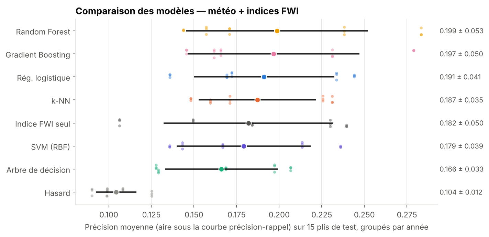

---

## The data — built for this project

No ready-made Tunisian dataset exists. It was built by combining two public sources
([`src/data.py`](src/data.py)):

| Source | Content |
|---|---|
| **[NASA FIRMS](https://firms.modaps.eosdis.nasa.gov/)** — VIIRS S-NPP satellite (375 m) | Every active-fire detection in Tunisia, 2013–2025 (≈ 48,000 detections) |
| **[Open-Meteo](https://open-meteo.com/)** — ERA5 reanalysis | Daily weather: max. temperature, min. humidity, max. wind, rainfall |

**7 forest zones**, every day from 1 June to 30 September, 2013 to 2025:

| Zone | Governorate | Fire days |
|---|---|---|
| Le Kef | Le Kef | 244 (15 %) |
| Nefza | Béja | 209 (13 %) |
| Sejnane | Bizerte | 203 (13 %) |
| Chaambi | Kasserine | 186 (12 %) |
| Aïn Draham | Jendouba | 185 (12 %) |
| Cap Bon | Nabeul | 67 (4 %) |
| Kesra | Siliana | 66 (4 %) |

→ **11,102 zone-days, of which 1,160 had a fire (10.4 %)**.

**Label:** a zone-day is a "fire day" if the satellite detected at least one vegetation fire (type 0, nominal or high
confidence) within 25 km of the zone centre. Each detection is assigned to the nearest zone.

**Features:**
- **Weather of the day** (4): `Temperature`, `RH`, `Ws`, `Rain`;
- **Canadian Fire Weather Index (FWI) system** (6): `FFMC`, `DMC`, `DC` (fuel moisture codes), `ISI`, `BUI`, `FWI`.
  They are **computed in this project** from the weather ([`src/fwi.py`](src/fwi.py), Van Wagner 1987 equations),
  day by day from 1 March of each year. The code exactly reproduces the official reference example
  (FFMC 87.69, DMC 8.55, DC 19.01, ISI 10.85, BUI 8.49, FWI 10.10).

Two scenarios: **weather only** (a simple weather station) and **weather + FWI** (drought accumulated over previous days).

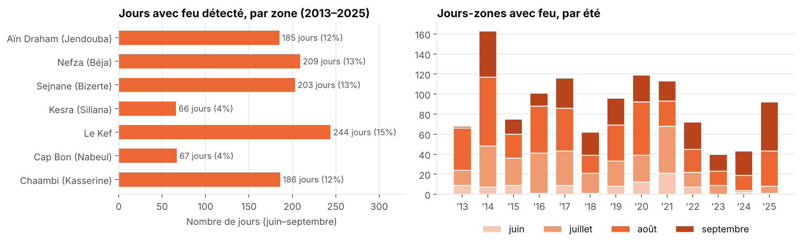

| | |
|---|---|
| 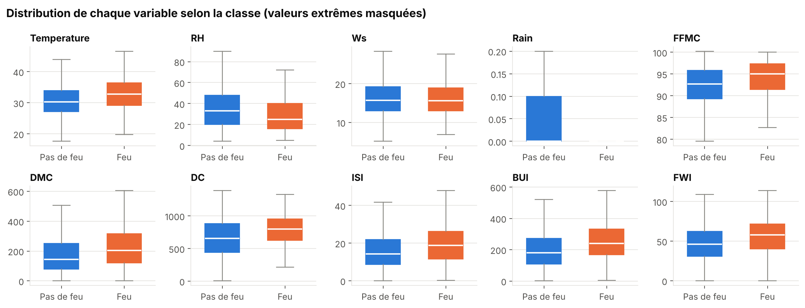 | 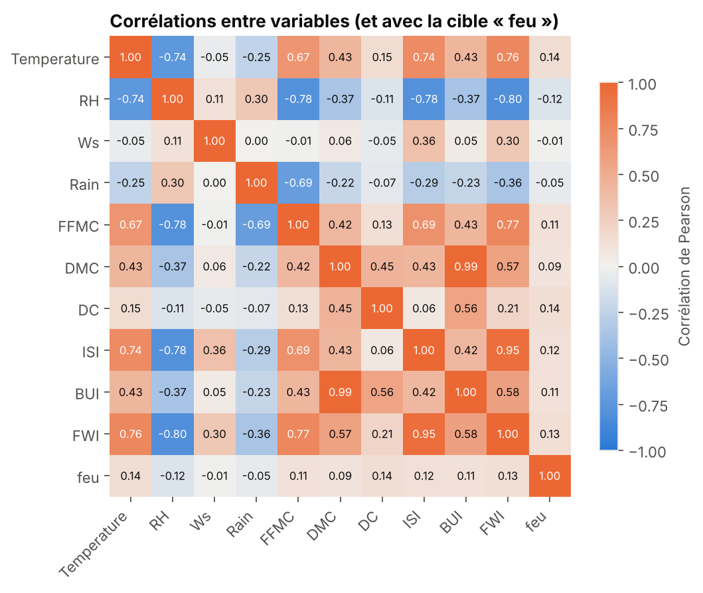 |

---

## Method

### The competing models

| Family | Model | Tuned hyper-parameters | Rare class |
|---|---|---|---|
| Baseline | Random (`DummyClassifier`) | — | — |
| Baseline | Official FWI index alone | — | — |
| Linear | Logistic regression | `C` | `class_weight="balanced"` |
| Instance-based | k-NN | `k` ∈ {5, 15, 31, 61, 101}, weights | not supported |
| Trees | Decision tree | depth, min. leaf size | `balanced` |
| Ensemble (bagging) | Random Forest (200 trees) | depth, min. leaf size | `balanced_subsample` |
| Ensemble (boosting) | Gradient Boosting (histogram-based) | learning rate, depth | `balanced` |
| Kernel methods | SVM (RBF kernel) | `C`, `gamma` | `balanced` |

### Nested cross-validation, grouped by year

```
Outer loop: 5 folds × 3 repetitions = 15 test folds   → measures performance
   │  all days of the same summer are in the same fold
   └── Inner loop: 3 folds grouped by year            → chooses hyper-parameters (GridSearchCV)
```

- Hyper-parameters are **never chosen by looking at the test summer**.
- Scaling lives inside a `Pipeline`: it is learned on the training data only (**no data leakage**).
- **Main metric: average precision** (area under the precision-recall curve). With 10 % fire days, always answering
  "no fire" gives 90 % accuracy, so accuracy is misleading. ROC-AUC, F1, precision and recall are also reported.
- Differences are tested with the **Nadeau & Bengio (2003) corrected resampled t-test** (folds of a repeated
  cross-validation are not independent).

---

## Analysis

### 1. The algorithm families are close

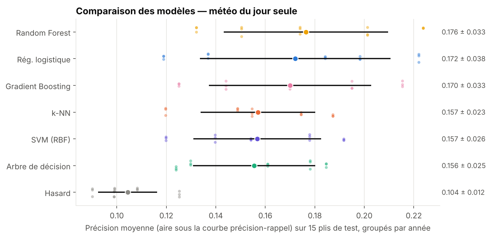

- **With the FWI indices**, Random Forest leads (0.199), but the gap with Gradient Boosting (p = 0.45), logistic regression
  (p = 0.57), k-NN (p = 0.44) and SVM (p = 0.30) **is not significant**. Only the single decision tree is behind (p = 0.045):
  one tree has too much variance, and averaging 200 trees (Random Forest) fixes it.
- **With weather only**, every model loses 10 to 15 % of precision. Random Forest and logistic regression stay on top (tied);
  Gradient Boosting is slightly but consistently behind, and k-NN, SVM and the single tree are clearly behind.
- **The standard deviation is large** (± 0.04 to 0.05): some summers are much more predictable than others.
- **Chosen hyper-parameters:** strongly regularised models (logistic regression `C = 0.01`, Random Forest depth 6,
  k-NN with 101 neighbours). A sign of a weak, noisy signal that needs a lot of averaging.

### 2. Why it is hard — and which features matter

| Weather + FWI | Weather only |
|---|---|
| 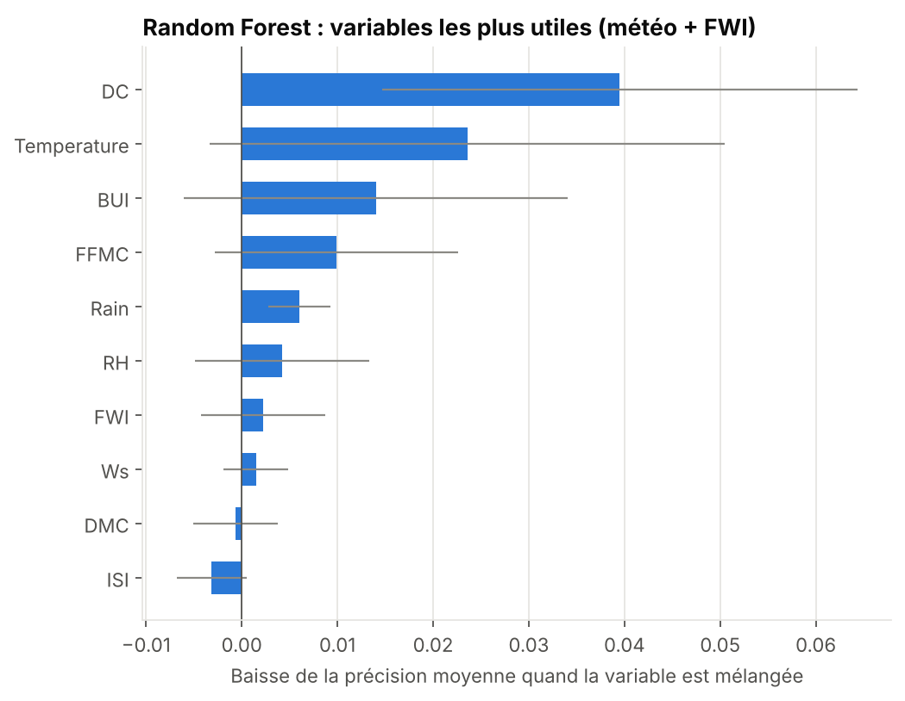 | 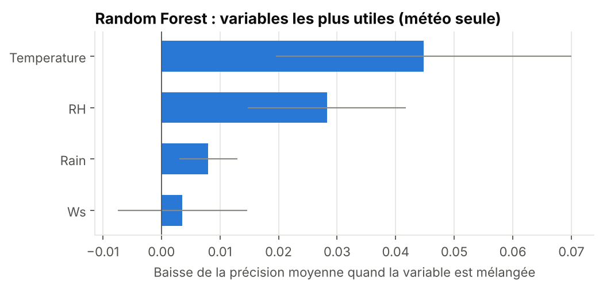 |

A fire needs **dry fuel** (which the weather measures) and a **spark** (which the weather cannot see). The models mostly learn
*when the ground is ready*: the **drought code `DC`** (drought accumulated since spring) and **temperature** are the most useful
features. With weather only: temperature, then humidity.

### 3. The temporal-leakage trap

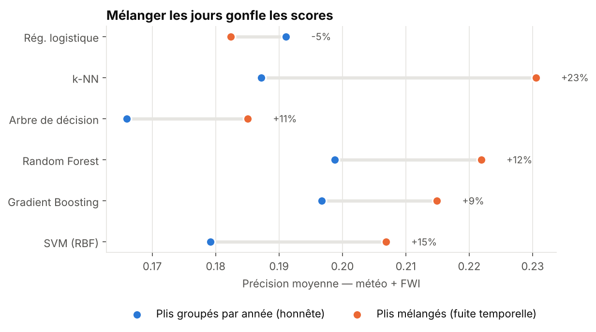

With randomly shuffled folds, the day after a fire lands in the test set while the fire itself is in the training set, and the
drought codes barely change from one day to the next. The model **recognises** instead of **predicting**. k-NN, which literally
looks for the closest days, would gain +23 % and jump from 4th to 1st place: **the ranking would be wrong**. Hence the
year-grouped folds.

### 4. Does feature scaling matter?

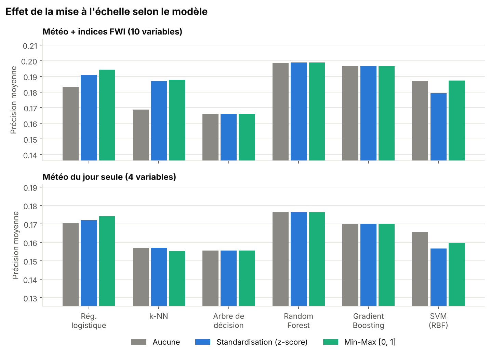

| Average precision (weather + FWI) | None | Standardisation | Min-Max |
|---|---|---|---|
| k-NN | 0.169 | 0.187 | **0.188** |
| Logistic regression | 0.183 | 0.191 | **0.194** |
| SVM (RBF) | **0.187** | 0.179 | **0.187** |
| Tree / Random Forest / Boosting | identical | identical | identical |

- **Trees and ensembles: no effect.** They split on one feature at a time: changing units moves the threshold, not the decision.
- **k-NN: +11 %.** Without scaling, `DC` and `BUI` (hundreds) drown out temperature and humidity (tens) in the distance.
- **SVM: slightly worse with standardisation.** Scaling is good practice, not a guarantee.

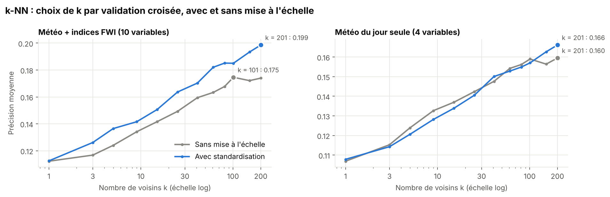

The best `k` is very large (100 to 200 neighbours): many days must be averaged to estimate a low risk.

### 5. Generalisation: an unseen zone, future summers

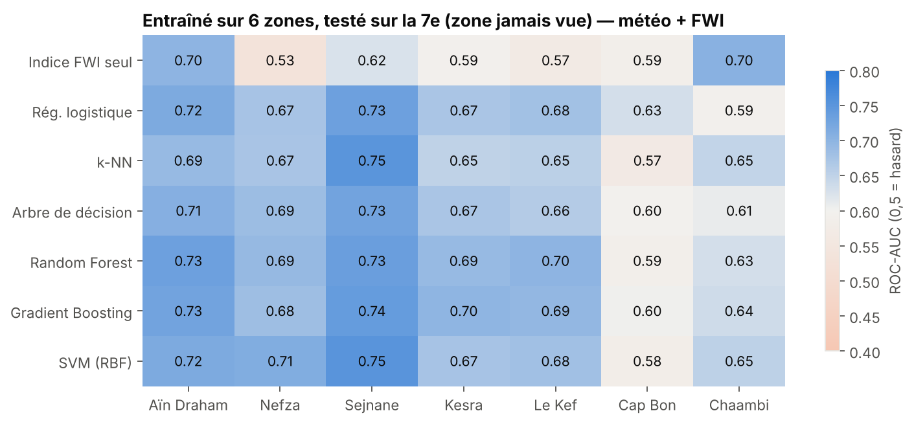

Trained on 6 zones and tested on the 7th, the models transfer well between north-western forests (ROC-AUC 0.65–0.75), less
well to **Cap Bon** and **Chaambi**, which have different climates. The FWI index alone is very uneven (0.53 to 0.70).

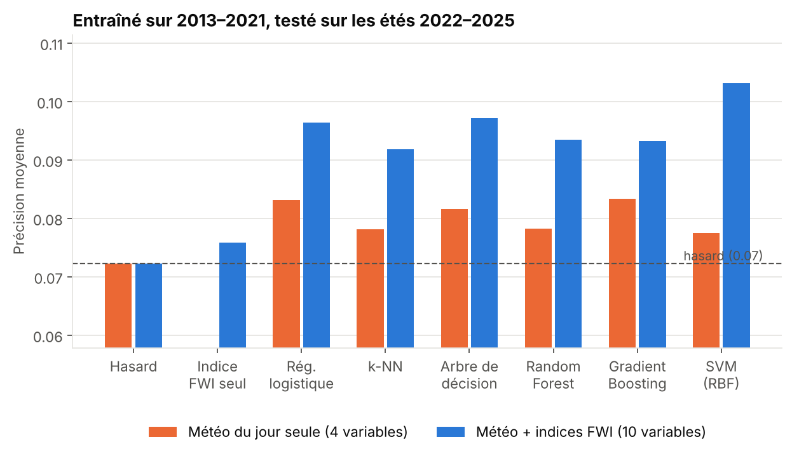

Trained on **2013–2021** and tested on **2022–2025**, the models stay above random (ROC-AUC 0.60–0.63 with the indices) but
lose precision. **The FWI index alone barely beats random** (ROC-AUC 0.51): this is where learning adds the most.

### 6. What kind of errors?

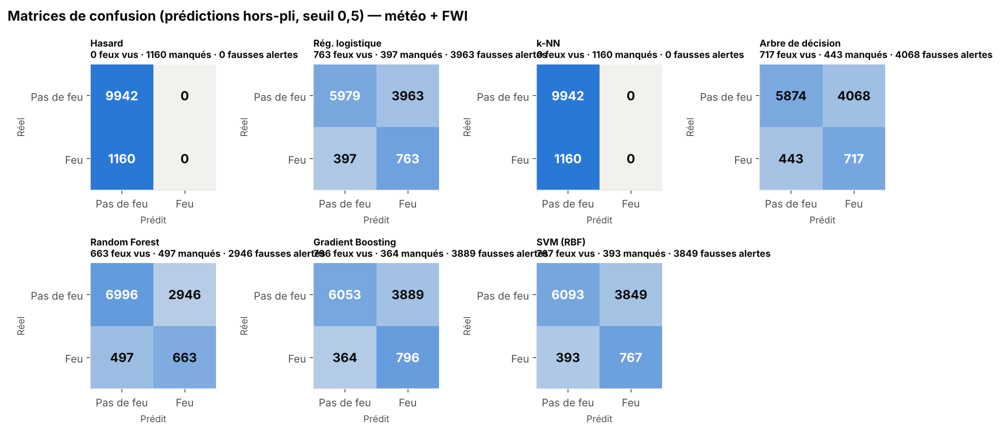

At a 0.5 threshold, models that weight the classes detect 57 to 69 % of fires, at the cost of many false alarms. **k-NN**,
which cannot weight the classes, **never raises an alarm**: its F1 is zero while its average precision is reasonable. The
threshold should be set according to the cost of an alarm — hence the value of a threshold-independent metric.

### 7. Performance vs cost

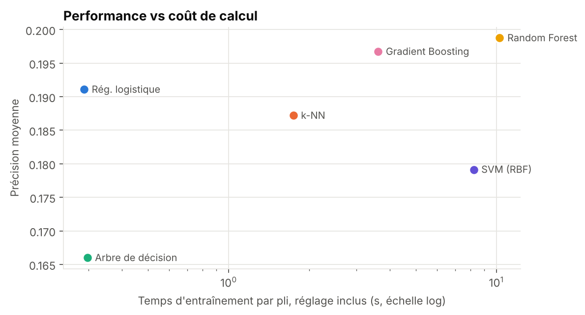

---

## Conclusion

| Criterion | Choice | Why |
|---|---|---|
| Best score | **Random Forest** | best average precision in both scenarios, robust across zones |
| Best simplicity / score trade-off | **Logistic regression** | statistically tied, 35× faster, interpretable coefficients |
| Avoid | Single decision tree, unweighted k-NN | too much variance; no alarm at the default threshold |

**On real, noisy data, no algorithm works miracles**: the gaps between families are small, and *how* models are evaluated
(year-grouped folds, the right metric) matters as much as which model is chosen. Machine learning slightly improves on the
official index and can help **prioritise the days and zones to watch**, not predict every fire.

### Limitations

- The satellite misses small fires, and a detected fire may be an **agricultural burn** near the forest.
- Weather comes from a reanalysis (≈ 25 km grid); noon humidity and wind are approximated by the daily extremes, which
  inflates the `DMC` and `DC` codes.
- The **human causes** of fire ignitions are not in the data.
- The detected-fire rate drops in 2022–2025 (7 % vs 11 % before), which makes the temporal test harder.

### Next steps

- Add vegetation (NDVI), population density and roads to approximate ignition risk.
- Predict one day ahead from weather forecasts; set the alarm threshold according to the cost of a false alarm.
- Add other satellites (VIIRS NOAA-20, MODIS) to better capture small fires.

---

## Project structure

```
predicting-forest-fire-machine-learning/
├── data/
│   ├── raw/tunisie/          # raw files: Open-Meteo weather + NASA FIRMS detections (2013-2025)
│   └── processed/tunisie_feux.csv
├── src/
│   ├── data.py               # dataset construction (satellite + weather merge)
│   ├── fwi.py                # computation of the 6 Canadian FWI system indices
│   ├── models.py             # the 8 models + hyper-parameter grids
│   └── evaluation.py         # year-grouped nested cross-validation, tests, generalisation…
├── notebooks/analyse.ipynb   # the full step-by-step analysis (in French)
├── reports/
│   ├── figures/              # all figures
│   └── results/              # all raw results (CSV / JSON)
├── docs/                     # the results website (GitHub Pages)
├── site/template.html        # website template
├── run_experiments.py        # runs every experiment
├── make_figures.py           # builds the figures
├── make_site.py              # builds the website in docs/
└── requirements.txt
```

## Reproduce

```bash
python -m venv .venv
.venv\Scripts\activate          # Windows  (Linux/macOS: source .venv/bin/activate)
pip install -r requirements.txt

python -m src.data                # rebuilds the dataset from data/raw/tunisie
python run_experiments.py         # ~45 min (quick version: --quick, ~15 min)
python make_figures.py
python make_site.py
```

**Raw data:** weather from the [Open-Meteo API](https://open-meteo.com/en/docs/historical-weather-api)
(7 points, 2013–2025, daily variables); fires from the yearly per-country files of
[NASA FIRMS](https://firms.modaps.eosdis.nasa.gov/country/) (VIIRS S-NPP, Tunisia).

## Publishing the website

The website is live at **https://yuumii05.github.io/predicting-forest-fire-machine-learning/**. To publish it from your own
copy on GitHub: **Settings → Pages → Build and deployment → Source: Deploy from a branch**, branch `main`, folder **`/docs`**.
It is then available at `https://<your-username>.github.io/predicting-forest-fire-machine-learning/`.

## References

- NASA FIRMS — *VIIRS 375 m Active Fire Product* (Schroeder et al., 2014), LANCE / NASA EOSDIS.
- Hersbach et al. (2020). *The ERA5 global reanalysis.* Q. J. R. Meteorol. Soc. — via Open-Meteo (Zippenfenig, 2023).
- Van Wagner, C.E. (1987). *Development and Structure of the Canadian Forest Fire Weather Index System.* Canadian Forestry Service.
- C. Nadeau & Y. Bengio (2003). *Inference for the Generalization Error.* Machine Learning, 52, 239–281.

---

**Author:** **Maram Bougossa** - [GitHub](https://github.com/YuuMii05)
