# Prédire les feux de forêt en Tunisie — comparaison de modèles de Machine Learning

<p align="center">
  <a href="https://yuumii05.github.io/predicting-forest-fire-machine-learning/">
    
  </a>
  <br>
  <a href="https://yuumii05.github.io/predicting-forest-fire-machine-learning/"><strong>https://yuumii05.github.io/predicting-forest-fire-machine-learning/</strong></a>
</p>

> **À partir de la météo d'une journée, peut-on prédire s'il y aura un feu dans une forêt tunisienne ?**
> Six familles d'algorithmes, deux références, un jeu de données construit à partir des satellites de la NASA, une validation croisée imbriquée groupée par année, et une analyse de *pourquoi* les modèles réussissent ou échouent.

Chaque été, les forêts du nord-ouest tunisien (Jendouba, Béja, Bizerte, Le Kef…) et du centre (Kasserine) brûlent.
Ce projet construit un jeu de données réel sur 13 étés et compare rigoureusement des modèles de classification capables
d'aider à **prioriser la surveillance** des zones et des journées à risque.

*Projet réalisé dans le cadre du cours de Machine Learning — ESGITECH.*

---

## Résultats en bref

| Modèle | Famille | Précision moyenne — météo + FWI | Précision moyenne — météo seule |
|---|---|---|---|
| **Random Forest** | Ensemble (bagging) | **0.199** ± 0.055 | **0.176** ± 0.034 |
| Gradient Boosting | Ensemble (boosting) | 0.197 ± 0.052 | 0.170 ± 0.034 |
| Régression logistique | Linéaire | 0.191 ± 0.043 | 0.172 ± 0.040 |
| k-NN | Basé sur les instances | 0.187 ± 0.036 | 0.157 ± 0.024 |
| SVM (noyau RBF) | Méthodes à noyau | 0.179 ± 0.041 | 0.157 ± 0.027 |
| Arbre de décision | Arbres | 0.166 ± 0.034 | 0.156 ± 0.026 |
| *Indice FWI officiel seul* | *Référence* | *0.182 ± 0.052* | — |
| *Hasard* | *Référence* | *0.104* | *0.104* |

*Précision moyenne = aire sous la courbe précision-rappel (classe positive = feu). Moyenne ± écart-type sur 15 plis de test
groupés par année (5 plis × 3 répétitions). Le hasard vaut le taux de jours avec feu : 0.104.*

**Ce qu'il faut retenir :**

1. **Prédire un feu à partir de la météo est difficile.** Le meilleur modèle (Random Forest) est **1,9× meilleur que le hasard**
   pour repérer les journées à risque (ROC-AUC ≈ 0.69). La météo dit quand la forêt est *prête* à brûler, pas quand quelqu'un
   allume l'étincelle — et la plupart des feux en Tunisie sont d'origine humaine.
2. **Les familles sont proches.** Avec les indices FWI, Random Forest, Gradient Boosting, régression logistique, k-NN et SVM sont
   **statistiquement à égalité** (test de Student corrigé, p > 0.3). Seul l'arbre de décision seul est significativement derrière.
   L'indice FWI officiel utilisé seul fait presque aussi bien en validation croisée.
3. **Mélanger les jours fausse tout.** Avec une validation croisée classique, le k-NN gagne **+23 %** et passe du 4e au 1er rang :
   un grand feu dure plusieurs jours, le modèle reconnaît « le feu de la veille ». Les plis sont donc groupés par année.
4. **Sur des étés futurs (2022–2025)**, tous les modèles restent au-dessus du hasard mais perdent en précision ; l'indice FWI seul,
   lui, ne fait presque pas mieux que le hasard (ROC-AUC 0.51). C'est là que l'apprentissage apporte le plus.
5. **La mise à l'échelle** fait gagner +11 % au k-NN (10 variables), ne change rien aux arbres, et fait même légèrement reculer le SVM.

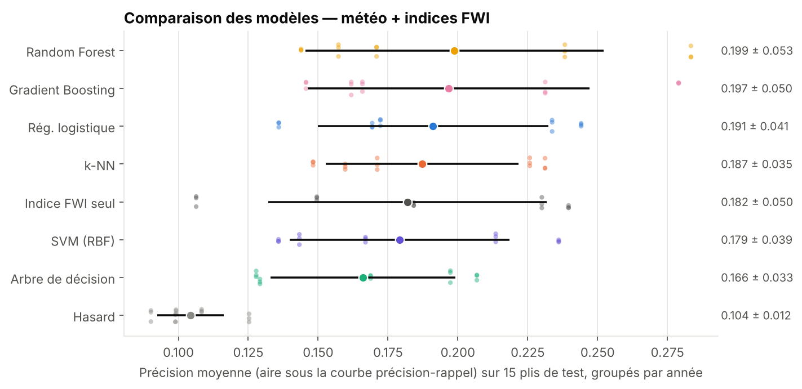

---

## Les données — construites pour ce projet

Aucun jeu de données tunisien prêt à l'emploi n'existe. Il a été construit en croisant deux sources publiques
([`src/data.py`](src/data.py)) :

| Source | Contenu |
|---|---|
| **[NASA FIRMS](https://firms.modaps.eosdis.nasa.gov/)** — satellite VIIRS S-NPP (375 m) | Toutes les détections de feux actifs en Tunisie, 2013–2025 (≈ 48 000 détections) |
| **[Open-Meteo](https://open-meteo.com/)** — réanalyse ERA5 | Météo quotidienne : température max., humidité min., vent max., pluie |

**7 zones forestières**, chaque jour du 1ᵉʳ juin au 30 septembre, de 2013 à 2025 :

| Zone | Gouvernorat | Jours avec feu |
|---|---|---|
| Le Kef | Le Kef | 244 (15 %) |
| Nefza | Béja | 209 (13 %) |
| Sejnane | Bizerte | 203 (13 %) |
| Chaambi | Kasserine | 186 (12 %) |
| Aïn Draham | Jendouba | 185 (12 %) |
| Cap Bon | Nabeul | 67 (4 %) |
| Kesra | Siliana | 66 (4 %) |

→ **11 102 journées-zones, dont 1 160 avec feu (10,4 %)**.

**Étiquette :** une journée-zone est « avec feu » si le satellite a détecté au moins un feu de végétation (type 0, confiance
moyenne ou haute) à moins de 25 km du centre de la zone. Chaque détection est attribuée à la zone la plus proche.

**Variables :**
- **Météo du jour** (4) : `Temperature`, `RH`, `Ws`, `Rain` ;
- **Indices du système canadien FWI** (6) : `FFMC`, `DMC`, `DC` (humidité des combustibles), `ISI`, `BUI`, `FWI`.
  Ils sont **calculés par moi-même** à partir de la météo ([`src/fwi.py`](src/fwi.py), équations de Van Wagner 1987),
  jour après jour depuis le 1ᵉʳ mars de chaque année. Le code reproduit exactement l'exemple de référence officiel
  (FFMC 87.69, DMC 8.55, DC 19.01, ISI 10.85, BUI 8.49, FWI 10.10).

Deux scénarios : **météo seule** (une station météo simple) et **météo + FWI** (sécheresse accumulée des jours précédents).

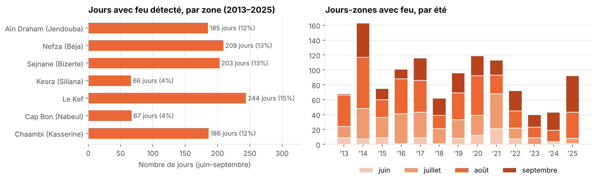

| | |
|---|---|
| 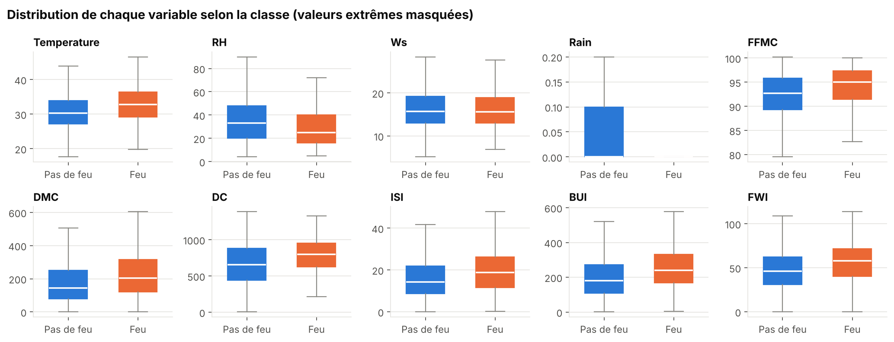 | 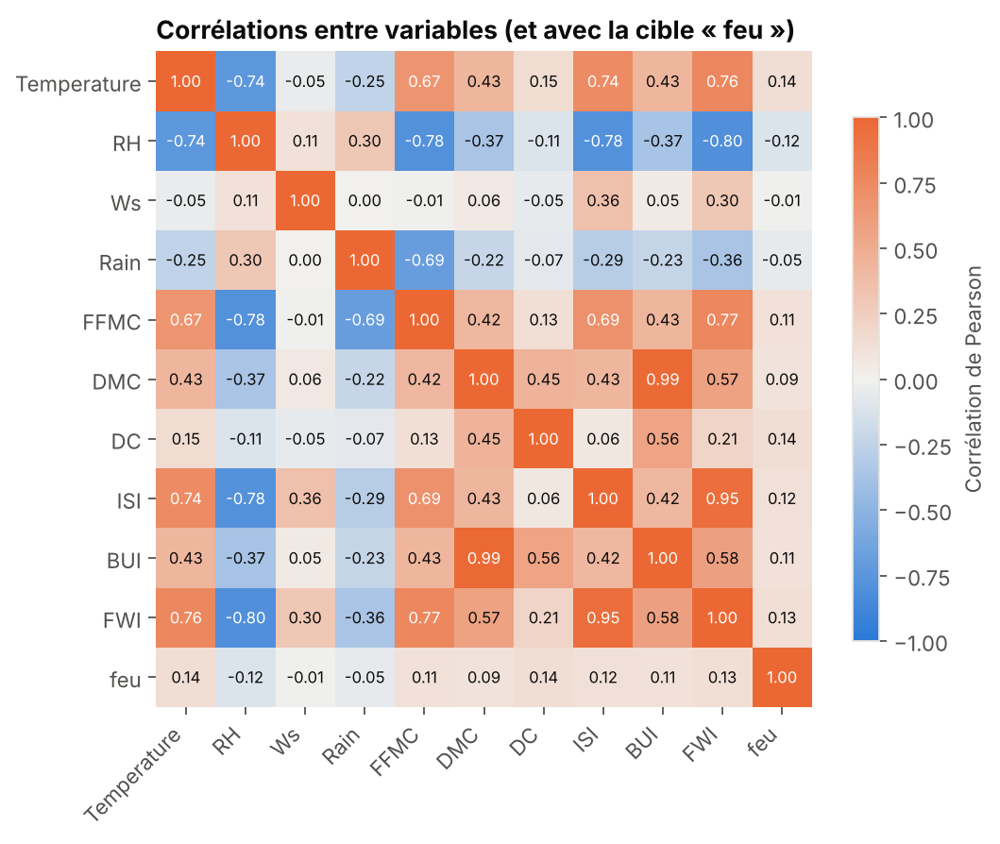 |

---

## Protocole

### Les modèles en compétition

| Famille | Modèle | Hyper-paramètres optimisés | Classes rares |
|---|---|---|---|
| Référence | Hasard (`DummyClassifier`) | — | — |
| Référence | Indice FWI officiel seul | — | — |
| Linéaire | Régression logistique | `C` | `class_weight="balanced"` |
| Basé sur les instances | k-NN | `k` ∈ {5, 15, 31, 61, 101}, poids | impossible |
| Arbres | Arbre de décision | profondeur, taille min. des feuilles | `balanced` |
| Ensemble (bagging) | Random Forest (200 arbres) | profondeur, taille min. des feuilles | `balanced_subsample` |
| Ensemble (boosting) | Gradient Boosting (histogrammes) | learning rate, profondeur | `balanced` |
| Méthodes à noyau | SVM (noyau RBF) | `C`, `gamma` | `balanced` |

### Validation croisée imbriquée, groupée par année

```
Boucle externe : 5 plis × 3 répétitions = 15 plis de test   → mesure la performance
   │  tous les jours d'un même été sont dans le même pli
   └── Boucle interne : 3 plis groupés par année           → choisit les hyper-paramètres (GridSearchCV)
```

- Les hyper-paramètres ne sont **jamais choisis en regardant l'été de test**.
- La mise à l'échelle est dans un `Pipeline` : apprise sur l'entraînement uniquement (**pas de fuite de données**).
- **Métrique principale : précision moyenne** (aire sous la courbe précision-rappel). Avec 10 % de jours de feu, répondre
  « jamais de feu » donne 90 % d'accuracy : l'accuracy est trompeuse. On rapporte aussi ROC-AUC, F1, précision, rappel.
- Écarts testés avec le **test de Student corrigé de Nadeau & Bengio (2003)** (les plis d'une validation croisée répétée ne sont
  pas indépendants).

---

## Analyse

### 1. Les familles d'algorithmes sont proches

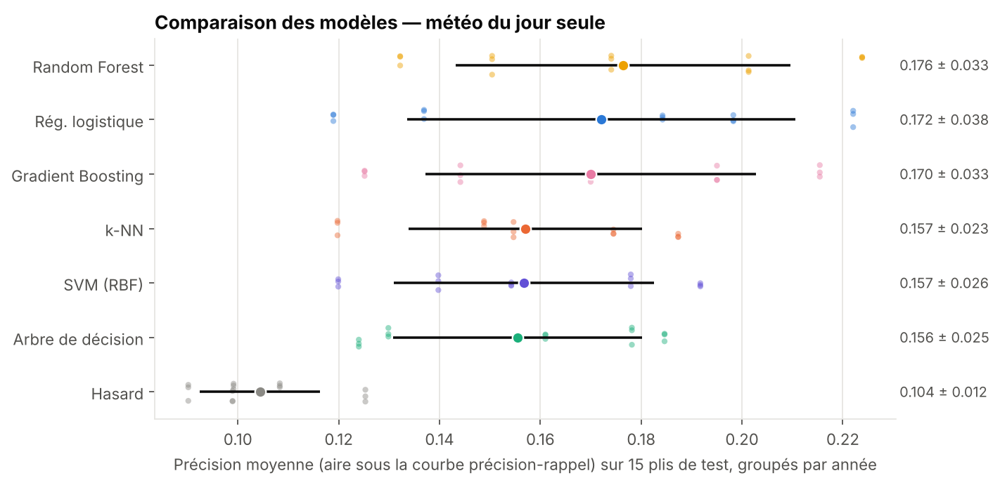

- **Avec les indices FWI**, Random Forest est en tête (0.199), mais l'écart avec Gradient Boosting (p = 0.45), la régression
  logistique (p = 0.57), le k-NN (p = 0.44) et le SVM (p = 0.30) **n'est pas significatif**. Seul l'arbre de décision seul est
  derrière (p = 0.045) : un arbre unique a trop de variance, la moyenne de 200 arbres (Random Forest) la corrige.
- **Avec la météo seule**, tous perdent 10 à 15 % de précision. Random Forest et la régression logistique restent en tête
  (à égalité) ; Gradient Boosting est derrière de très peu mais de façon régulière, k-NN, SVM et arbre seul nettement derrière.
- **L'écart-type est grand** (± 0.04 à 0.05) : certains étés sont bien plus prévisibles que d'autres.
- **Hyper-paramètres choisis :** des modèles très régularisés (régression logistique `C = 0.01`, Random Forest de profondeur 6,
  k-NN à 101 voisins). Signe d'un signal faible et bruité : il faut moyenner beaucoup.

### 2. Pourquoi c'est difficile — et quelles variables comptent

| Météo + FWI | Météo seule |
|---|---|
| 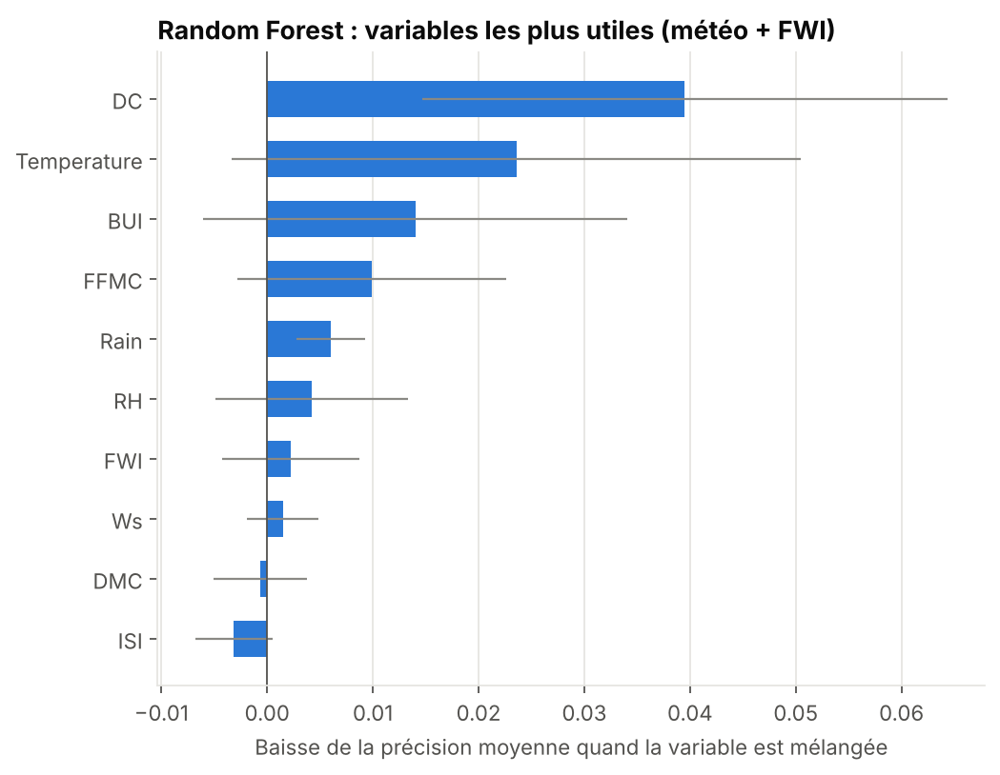 | 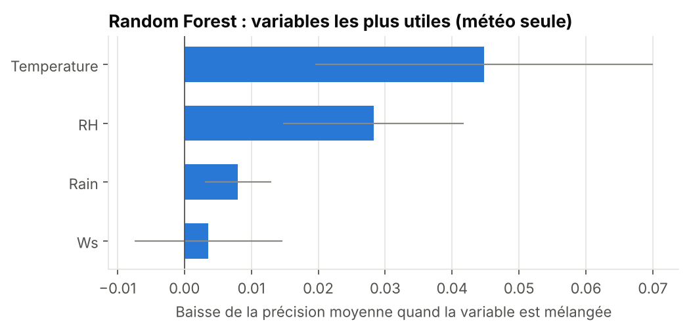 |

Un feu a besoin d'un **combustible sec** (que la météo mesure) et d'une **étincelle** (que la météo ne voit pas). Les modèles
apprennent surtout *quand le terrain est prêt* : le **code de sécheresse `DC`** (sécheresse accumulée depuis le printemps) et la
**température** sont les variables les plus utiles. Avec la météo seule : température, puis humidité.

### 3. Le piège de la fuite temporelle

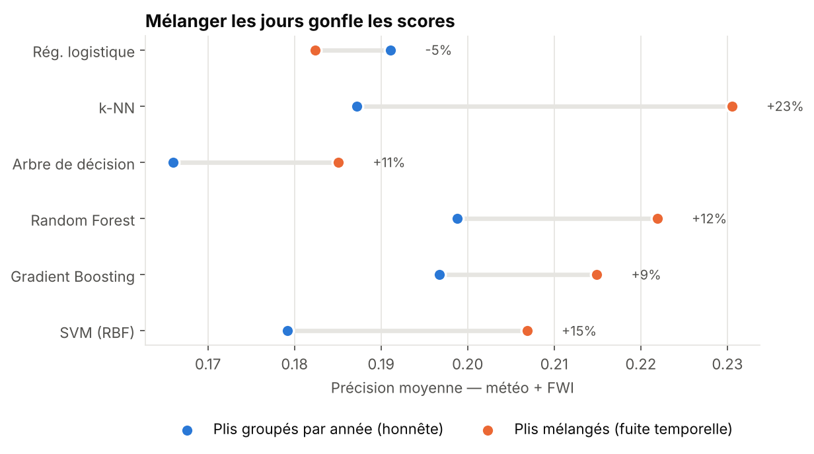

Avec des plis mélangés au hasard, le lendemain d'un feu se retrouve dans le test et le feu lui-même dans l'entraînement ;
les codes de sécheresse changent à peine d'un jour à l'autre. Le modèle **reconnaît** au lieu de **prédire**.
Le k-NN, qui cherche littéralement les jours les plus proches, gagnerait +23 % et passerait du 4e au 1er rang :
**le classement serait faux**. D'où les plis groupés par année.

### 4. La mise à l'échelle compte-t-elle ?

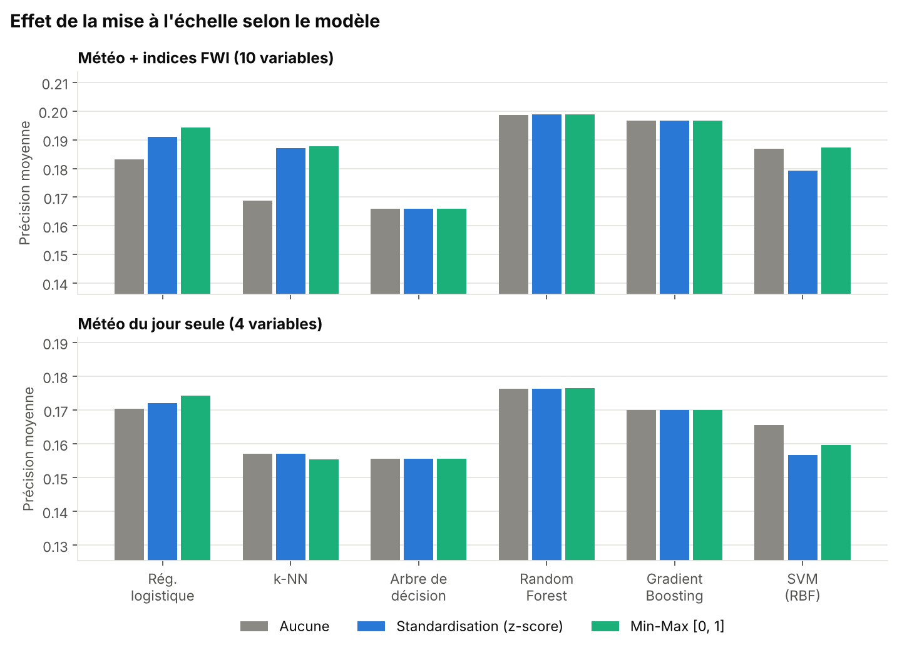

| Précision moyenne (météo + FWI) | Aucune | Standardisation | Min-Max |
|---|---|---|---|
| k-NN | 0.169 | 0.187 | **0.188** |
| Régression logistique | 0.183 | 0.191 | **0.194** |
| SVM (RBF) | **0.187** | 0.179 | **0.187** |
| Arbre / Random Forest / Boosting | identique | identique | identique |

- **Arbres et ensembles : aucun effet.** Ils coupent une variable à la fois : changer d'unité déplace le seuil, pas la décision.
- **k-NN : +11 %.** Sans mise à l'échelle, `DC` et `BUI` (des centaines) écrasent la température et l'humidité (des dizaines)
  dans le calcul de distance.
- **SVM : léger recul avec la standardisation.** La mise à l'échelle est une bonne pratique, pas une garantie.

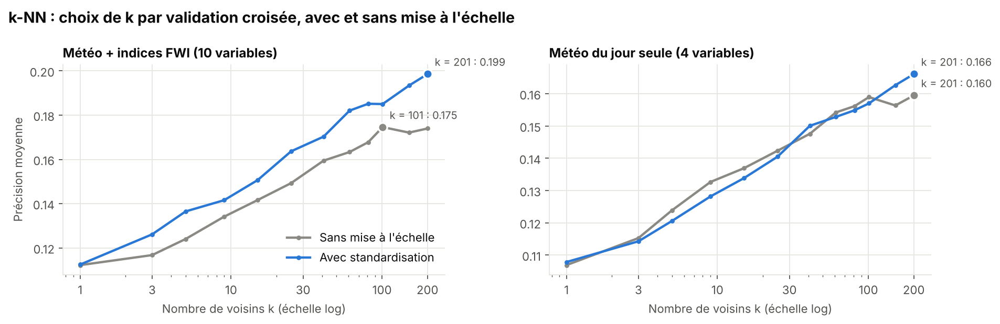

Le meilleur `k` est très grand (100 à 200 voisins) : il faut moyenner beaucoup de journées pour estimer un risque faible.

### 5. Généralisation : une zone jamais vue, des étés futurs

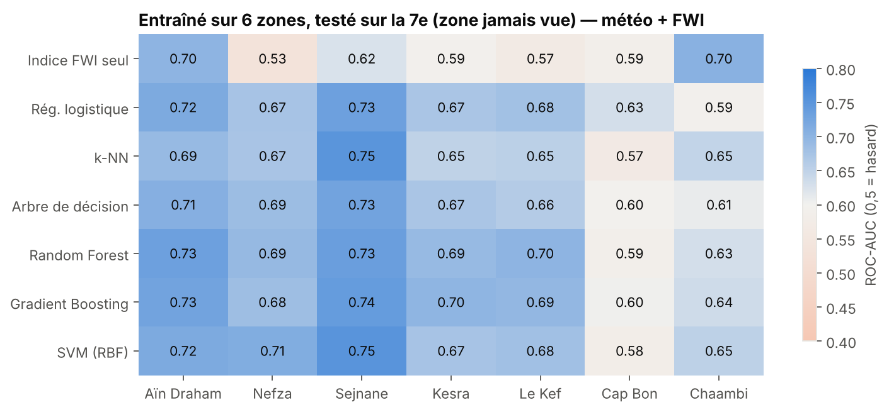

Entraînés sur 6 zones et testés sur la 7ᵉ, les modèles transfèrent bien entre forêts du nord-ouest (ROC-AUC 0.65–0.75),
moins bien vers le **Cap Bon** et **Chaambi**, aux climats différents. L'indice FWI seul est très inégal (0.53 à 0.70).

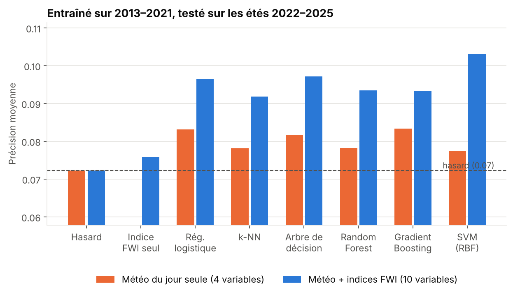

Entraînés sur **2013–2021** et testés sur **2022–2025**, les modèles restent au-dessus du hasard (ROC-AUC 0.60–0.63 avec les
indices) mais perdent en précision. **L'indice FWI seul ne fait presque pas mieux que le hasard** (ROC-AUC 0.51) :
c'est là que l'apprentissage apporte le plus.

### 6. Quelles erreurs ?

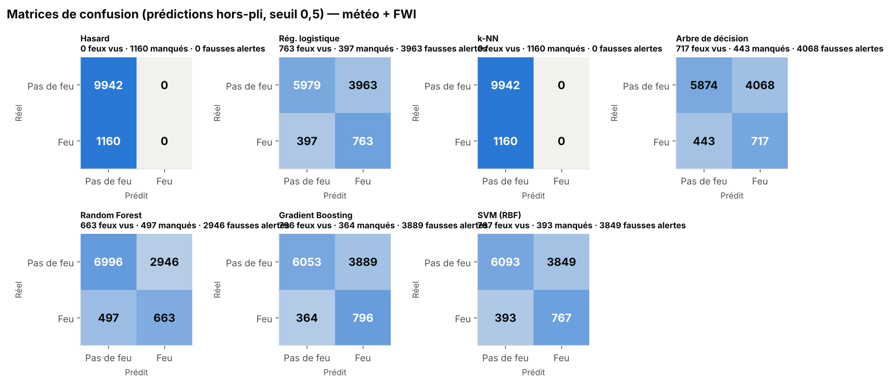

Au seuil 0,5, les modèles qui pondèrent les classes détectent 57 à 69 % des feux, au prix de nombreuses fausses alertes.
Le **k-NN**, qui ne peut pas pondérer les classes, **ne déclenche jamais d'alerte** : son F1 est nul alors que sa précision
moyenne est correcte. Le seuil doit être choisi selon le coût d'une alerte — d'où l'intérêt d'une métrique indépendante du seuil.

### 7. Performance vs coût

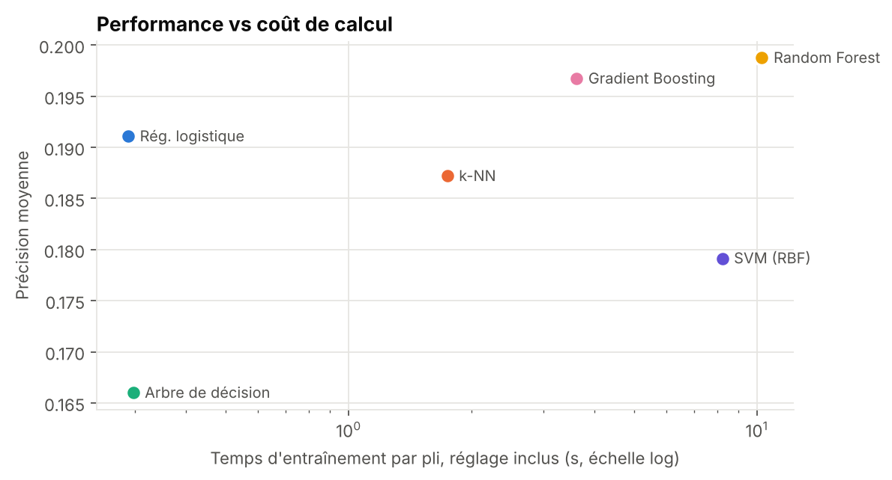

---

## Conclusion

| Critère | Choix | Pourquoi |
|---|---|---|
| Meilleur score | **Random Forest** | meilleure précision moyenne dans les deux scénarios, robuste d'une zone à l'autre |
| Meilleur rapport simplicité / score | **Régression logistique** | à égalité statistique, 35× plus rapide, coefficients interprétables |
| À éviter | Arbre de décision seul, k-NN sans pondération | trop de variance ; aucune alerte au seuil par défaut |

**Sur des données réelles et bruitées, aucun algorithme ne fait de miracle** : les écarts entre familles sont petits, et la
façon d'évaluer (plis groupés par année, bonne métrique) compte autant que le choix du modèle. Le machine learning améliore
un peu l'indice officiel et peut aider à **prioriser les journées et les zones à surveiller**, pas à prédire chaque feu.

### Limites

- Le satellite ne voit pas les petits feux, et un feu détecté peut être un **brûlage agricole** proche de la forêt.
- La météo vient d'une réanalyse (maille ≈ 25 km) ; l'humidité et le vent de midi sont approchés par les extrêmes du jour,
  ce qui gonfle les codes `DMC` et `DC`.
- Les **causes humaines** des départs de feu ne sont pas dans les données.
- Le taux de feux détectés baisse sur 2022–2025 (7 % contre 11 % avant), ce qui complique le test temporel.

### Pistes

- Ajouter la végétation (NDVI), la densité de population et les routes pour approcher le risque d'ignition.
- Prédire à J+1 avec les prévisions météo ; régler le seuil d'alerte selon le coût d'une fausse alerte.
- Ajouter d'autres satellites (VIIRS NOAA-20, MODIS) pour mieux couvrir les petits feux.

---

## Structure du projet

```
predicting-forest-fire-machine-learning/
├── data/
│   ├── raw/tunisie/          # fichiers bruts : météo Open-Meteo + détections NASA FIRMS (2013-2025)
│   └── processed/tunisie_feux.csv
├── src/
│   ├── data.py               # construction du jeu de données (fusion satellite + météo)
│   ├── fwi.py                # calcul des 6 indices du système canadien FWI
│   ├── models.py             # les 8 modèles + grilles d'hyper-paramètres
│   └── evaluation.py         # validation croisée imbriquée groupée par année, tests, généralisation…
├── notebooks/analyse.ipynb   # l'analyse complète, pas à pas
├── reports/
│   ├── figures/              # toutes les figures
│   └── results/              # tous les résultats bruts (CSV / JSON)
├── docs/                     # le site de résultats (GitHub Pages)
├── site/template.html        # modèle du site
├── run_experiments.py        # lance toutes les expériences
├── make_figures.py           # produit les figures
├── make_site.py              # construit le site dans docs/
└── requirements.txt
```

## Reproduire

```bash
python -m venv .venv
.venv\Scripts\activate          # Windows  (Linux/macOS : source .venv/bin/activate)
pip install -r requirements.txt

python -m src.data                # reconstruit le jeu de données depuis data/raw/tunisie
python run_experiments.py         # ~45 min (version rapide : --quick, ~15 min)
python make_figures.py
python make_site.py
```

**Données brutes :** la météo vient de l'[API Open-Meteo](https://open-meteo.com/en/docs/historical-weather-api)
(7 points, 2013–2025, variables quotidiennes) ; les feux des fichiers annuels par pays de
[NASA FIRMS](https://firms.modaps.eosdis.nasa.gov/country/) (VIIRS S-NPP, Tunisie).

## Publier le site

Le site est en ligne : **https://yuumii05.github.io/predicting-forest-fire-machine-learning/**. Pour le republier ailleurs, sur GitHub : **Settings → Pages → Build and deployment → Source : Deploy from a branch**, branche `main`, dossier **`/docs`**.
Le site est alors en ligne à l'adresse `https://<votre-pseudo>.github.io/predicting-forest-fire-machine-learning/`.

## Références

- NASA FIRMS — *VIIRS 375 m Active Fire Product* (Schroeder et al., 2014), LANCE / NASA EOSDIS.
- Hersbach et al. (2020). *The ERA5 global reanalysis.* Q. J. R. Meteorol. Soc. — via Open-Meteo (Zippenfenig, 2023).
- Van Wagner, C.E. (1987). *Development and Structure of the Canadian Forest Fire Weather Index System.* Canadian Forestry Service.
- C. Nadeau & Y. Bengio (2003). *Inference for the Generalization Error.* Machine Learning, 52, 239–281.

---

**Auteure :** Maram Bougossa — ESGITECH
